# Diagramas de Rede (CPM) — Kortex Hub

Este documento apresenta o **diagrama de rede** do MVP pelo Método do Caminho Crítico (CPM): para cada atividade, a predecessora, a duração, as datas de início e término mais cedo e mais tarde e a folga. As atividades com folga zero formam o **caminho crítico**, destacado em laranja nos diagramas.

São duas visões:

1. **Rede geral do projeto:** cada atividade é um requisito funcional (RF01 a RF13), mais as atividades de base (banco em nuvem, estrutura da API, projeto do app e banco local) e os testes integrados. A duração está em **dias de trabalho de 2 horas**.
2. **Rede de cada requisito:** as atividades necessárias para implementar o requisito em todas as camadas (banco, domínio, API, telas e testes). A duração está em **horas de trabalho**.

> **Premissas:** desenvolvimento solo, **2 horas por dia, de segunda a sexta**, a partir de **16/11/2026**. Feriados nacionais sem trabalho: 20/11/2026 (Consciência Negra), 25/12/2026 (Natal), 01/01/2027 (Confraternização Universal), 26/03/2027 (Sexta-feira Santa), 21/04/2027 (Tiradentes). As durações são **estimativas** de esforço para a stack definida (API em C# com Clean Architecture, app em Expo com SQLite).

**Rede x desenvolvedor único:** o CPM considera que atividades sem dependência entre si podem acontecer ao mesmo tempo. Com uma pessoa só, elas acontecem uma depois da outra. Por isso, cada tabela traz duas informações:
- o **caminho crítico** (59 dias), que mostra a ordem obrigatória e o que não pode atrasar;
- o **período previsto** com um desenvolvedor, em que as atividades são feitas em sequência, priorizando as de menor folga: **165 dias úteis**, de 16/11/2026 a 09/07/2027.

Na rede geral, a duração de cada requisito é o **esforço total** das atividades dele (todas são feitas pela mesma pessoa); dentro do requisito, o caminho crítico em horas é menor que o esforço, e a diferença é o trabalho que pode ser feito em qualquer ordem.

**Como ler os diagramas:** cada círculo é uma atividade. O número em cada seta é a duração da atividade de onde a seta sai. As atividades e setas em laranja estão no caminho crítico.

**Legenda das colunas:** *Início cedo* e *Término cedo* são o primeiro momento em que a atividade pode começar e terminar; *Início tarde* e *Término tarde* são o último momento possível sem atrasar o projeto; *Folga* = Início tarde − Início cedo.

---

## Sumário

- [1. Rede geral do projeto](#1-rede-geral-do-projeto)

- [2. RF01 — Gerir usuários](#2-rf01--gerir-usuários)
- [3. RF02 — Autenticar acesso](#3-rf02--autenticar-acesso)
- [4. RF03 — Visualizar central](#4-rf03--visualizar-central)
- [5. RF04 — Centralizar dados](#5-rf04--centralizar-dados)
- [6. RF05 — Gerir finanças](#6-rf05--gerir-finanças)
- [7. RF06 — Categorizar transações](#7-rf06--categorizar-transações)
- [8. RF07 — Gerir rotinas de treino](#8-rf07--gerir-rotinas-de-treino)
- [9. RF08 — Registrar treinos e exercícios](#9-rf08--registrar-treinos-e-exercícios)
- [10. RF09 — Gerir tarefas](#10-rf09--gerir-tarefas)
- [11. RF10 — Concluir atividades](#11-rf10--concluir-atividades)
- [12. RF11 — Backup na conta Google](#12-rf11--backup-na-conta-google)
- [13. RF12 — Comunicar com a plataforma](#13-rf12--comunicar-com-a-plataforma)
- [14. RF13 — Compartilhar rotina](#14-rf13--compartilhar-rotina)
- [15. Resumo dos caminhos críticos](#15-resumo-dos-caminhos-críticos)

---

## 1. Rede geral do projeto

**Caminho crítico = 59 dias de trabalho** (118 horas) · **Com 1 desenvolvedor: 165 dias úteis** (330 horas), de 16/11/2026 a 09/07/2027

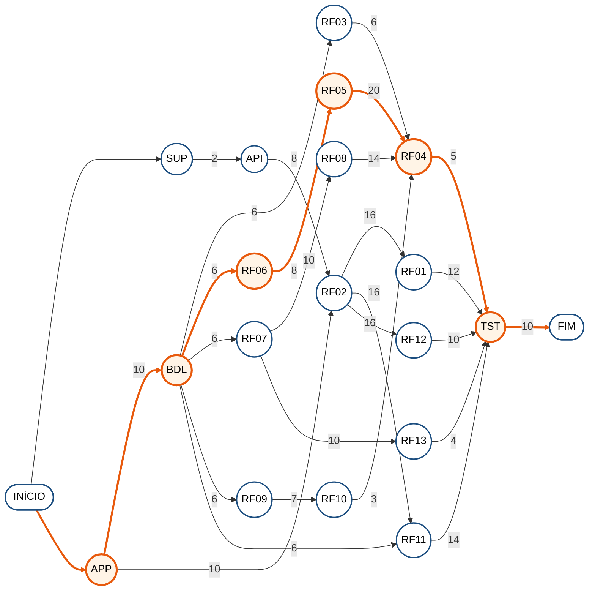

| Atividade | Descrição | Predecessora | Duração (dias) | Início cedo | Término cedo | Início tarde | Término tarde | Folga | Período previsto (1 dev) |
| :---: | :--- | :---: | :---: | :---: | :---: | :---: | :---: | :---: | :---: |
| SUP | Banco em nuvem: script do Supabase, papel da API e conexão (ADR-05) | — | 2 | 0 | 2 | 9 | 11 | 9 | 23/02/27 a 24/02/27 |
| API | Estrutura da API C# em Clean Architecture (ADR-14) e conexão com o banco | SUP | 8 | 2 | 10 | 11 | 19 | 9 | 25/02/27 a 08/03/27 |
| **APP** | Projeto Expo: development build, navegação, temas claro e escuro e componentes base (ADR-15) | — | 10 | 0 | 10 | 0 | 10 | **0** | 16/11/26 a 30/11/26 |
| **BDL** | Banco local: executor de migrações 001/002, repositório base, datas e dinheiro (ADR-08, ADR-09, ADR-12) | APP | 6 | 10 | 16 | 10 | 16 | **0** | 01/12/26 a 08/12/26 |
| RF02 | Autenticar acesso (32 h) | API, APP | 16 | 10 | 26 | 19 | 35 | 9 | 09/03/27 a 31/03/27 |
| RF01 | Gerir usuários (24 h) | RF02 | 12 | 26 | 38 | 37 | 49 | 11 | 22/04/27 a 07/05/27 |
| RF03 | Visualizar central (12 h) | BDL | 6 | 16 | 22 | 38 | 44 | 22 | 11/06/27 a 18/06/27 |
| **RF06** | Categorizar transações (16 h) | BDL | 8 | 16 | 24 | 16 | 24 | **0** | 09/12/26 a 18/12/26 |
| **RF05** | Gerir finanças (40 h) | RF06 | 20 | 24 | 44 | 24 | 44 | **0** | 21/12/26 a 19/01/27 |
| RF07 | Gerir rotinas de treino (20 h) | BDL | 10 | 16 | 26 | 20 | 30 | 4 | 20/01/27 a 02/02/27 |
| RF08 | Registrar treinos e exercícios (28 h) | RF07 | 14 | 26 | 40 | 30 | 44 | 4 | 03/02/27 a 22/02/27 |
| RF13 | Compartilhar rotina (8 h) | RF07 | 4 | 26 | 30 | 45 | 49 | 19 | 07/06/27 a 10/06/27 |
| RF09 | Gerir tarefas (14 h) | BDL | 7 | 16 | 23 | 34 | 41 | 18 | 24/05/27 a 01/06/27 |
| RF10 | Concluir atividades (6 h) | RF09 | 3 | 23 | 26 | 41 | 44 | 18 | 02/06/27 a 04/06/27 |
| **RF04** | Centralizar dados (10 h) | RF03, RF05, RF08, RF10 | 5 | 44 | 49 | 44 | 49 | **0** | 21/06/27 a 25/06/27 |
| RF11 | Backup na conta Google (28 h) | RF02, BDL | 14 | 26 | 40 | 35 | 49 | 9 | 01/04/27 a 20/04/27 |
| RF12 | Comunicar com a plataforma (20 h) | RF02 | 10 | 26 | 36 | 39 | 49 | 13 | 10/05/27 a 21/05/27 |
| **TST** | Testes integrados, persistência offline e homologação do MVP | RF01, RF04, RF11, RF12, RF13 | 10 | 49 | 59 | 49 | 59 | **0** | 28/06/27 a 09/07/27 |

**Caminho crítico:** APP → BDL → RF06 → RF05 → RF04 → TST = 10 + 6 + 8 + 20 + 5 + 10 = **59 dias**.

**Ordem de execução com 1 desenvolvedor:** APP → BDL → RF06 → RF05 → RF07 → RF08 → SUP → API → RF02 → RF11 → RF01 → RF12 → RF09 → RF10 → RF13 → RF03 → RF04 → TST.

**Leitura:** o projeto do app (APP) e o banco local (BDL) abrem o caminho crítico, porque todos os módulos dependem deles. Em seguida, o caminho passa por categorias (RF06) e finanças (RF05), o requisito mais longo, e pelo Dashboard (RF04), que só pode ser concluído quando finanças, treinos e tarefas estiverem prontos. Por fim, vêm os testes integrados. A parte em nuvem (Supabase, API, autenticação, backup e feedback) não está no caminho crítico: como o app funciona offline, ela pode ser feita depois dos módulos. Por isso, no cronograma com 1 desenvolvedor, a API começa só em fevereiro de 2027. As atividades com folga, como SUP (9 dias), API (9 dias), RF02 (9 dias), RF01 (11 dias), RF03 (22 dias), RF07 (4 dias), RF08 (4 dias), RF13 (19 dias), RF09 (18 dias), RF10 (18 dias), RF11 (9 dias), RF12 (13 dias), podem atrasar até o valor da folga sem mover o fim do caminho crítico.

---

## 2. RF01 — Gerir usuários

Consultar, atualizar, desativar e excluir a conta; promover e remover ADMs.

**Caminho crítico = 18 horas** · **Esforço total = 24 horas** (12 dias de 2 h na rede geral)

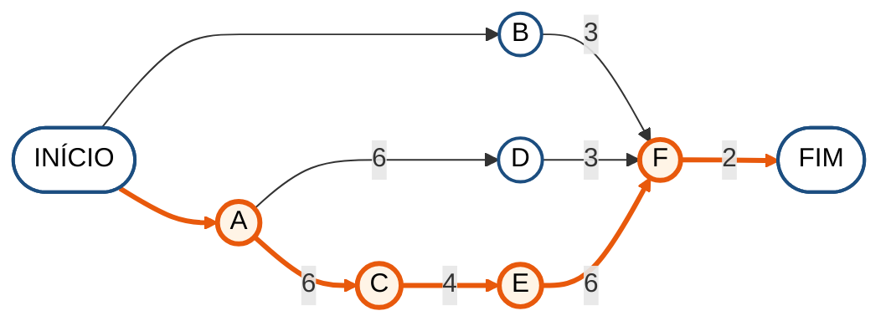

| Atividade | Descrição | Predecessora | Duração (horas) | Início cedo | Término cedo | Início tarde | Término tarde | Folga |
| :---: | :--- | :---: | :---: | :---: | :---: | :---: | :---: | :---: |
| **A** | Casos de uso na API: atualizar dados, desativar e excluir conta (RN34) | — | 6 | 0 | 6 | 0 | 6 | **0** |
| B | Exclusão no aparelho: banco local, armazenamento seguro e arquivo do Drive | — | 3 | 0 | 3 | 13 | 16 | 13 |
| **C** | Endpoints de conta e de ADM (promover e remover, RN41) | A | 4 | 6 | 10 | 6 | 10 | **0** |
| D | Testes unitários das regras de conta (último ADM, exclusão) | A | 3 | 6 | 9 | 13 | 16 | 7 |
| **E** | Telas Meus Dados, Menu Dados, Excluir Conta e Conta Excluída | C | 6 | 10 | 16 | 10 | 16 | **0** |
| **F** | Teste de integração do requisito | B, D, E | 2 | 16 | 18 | 16 | 18 | **0** |

**Caminho crítico:** A → C → E → F = 6 + 4 + 6 + 2 = **18 horas**.

---

## 3. RF02 — Autenticar acesso

Cadastro, login, tokens, códigos por e-mail, recuperação de senha e limite de tentativas.

**Caminho crítico = 23 horas** · **Esforço total = 32 horas** (16 dias de 2 h na rede geral)

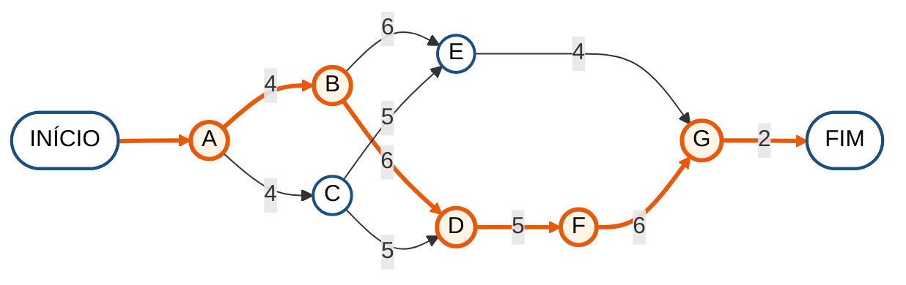

| Atividade | Descrição | Predecessora | Duração (horas) | Início cedo | Término cedo | Início tarde | Término tarde | Folga |
| :---: | :--- | :---: | :---: | :---: | :---: | :---: | :---: | :---: |
| **A** | Entidade Usuario, hash de senha e bloqueio por tentativas (RN03, RN35) | — | 4 | 0 | 4 | 0 | 4 | **0** |
| **B** | JWT de acesso e refresh token com rotação (ADR-10) | A | 6 | 4 | 10 | 4 | 10 | **0** |
| C | Códigos por e-mail e serviço de envio (RN05) | A | 5 | 4 | 9 | 5 | 10 | 1 |
| **D** | Endpoints de cadastro, login e recuperação; limitador de taxa (RN35) | B, C | 5 | 10 | 15 | 10 | 15 | **0** |
| E | Testes unitários de autenticação | B, C | 4 | 10 | 14 | 17 | 21 | 7 |
| **F** | Telas Login, Cadastro, Confirmar Código e Nova Senha; SecureStore | D | 6 | 15 | 21 | 15 | 21 | **0** |
| **G** | Teste de integração do requisito | E, F | 2 | 21 | 23 | 21 | 23 | **0** |

**Caminho crítico:** A → B → D → F → G = 4 + 6 + 5 + 6 + 2 = **23 horas**.

---

## 4. RF03 — Visualizar central

Dashboard com calendário semanal e mensal.

**Caminho crítico = 10 horas** · **Esforço total = 12 horas** (6 dias de 2 h na rede geral)

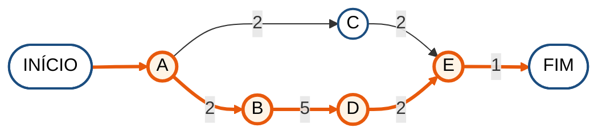

| Atividade | Descrição | Predecessora | Duração (horas) | Início cedo | Término cedo | Início tarde | Término tarde | Folga |
| :---: | :--- | :---: | :---: | :---: | :---: | :---: | :---: | :---: |
| **A** | Funções de data local e da semana do calendário (ADR-12) | — | 2 | 0 | 2 | 0 | 2 | **0** |
| **B** | Carrossel de dias e calendário mensal | A | 5 | 2 | 7 | 2 | 7 | **0** |
| C | Testes das funções de data | A | 2 | 2 | 4 | 7 | 9 | 5 |
| **D** | Data selecionada compartilhada com os blocos da Home (RN09) | B | 2 | 7 | 9 | 7 | 9 | **0** |
| **E** | Teste de integração do requisito | C, D | 1 | 9 | 10 | 9 | 10 | **0** |

**Caminho crítico:** A → B → D → E = 2 + 5 + 2 + 1 = **10 horas**.

---

## 5. RF04 — Centralizar dados

Blocos da Home com finanças, treino e tarefas da data selecionada.

**Caminho crítico = 7 horas** · **Esforço total = 10 horas** (5 dias de 2 h na rede geral)

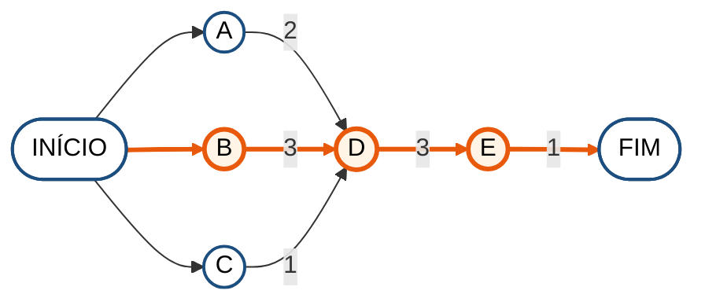

| Atividade | Descrição | Predecessora | Duração (horas) | Início cedo | Término cedo | Início tarde | Término tarde | Folga |
| :---: | :--- | :---: | :---: | :---: | :---: | :---: | :---: | :---: |
| A | Consulta do resumo financeiro do dia | — | 2 | 0 | 2 | 1 | 3 | 1 |
| **B** | Status do treino do dia: Pendente, Concluído ou Faltou (RN23) | — | 3 | 0 | 3 | 0 | 3 | **0** |
| C | Consulta das tarefas do dia | — | 1 | 0 | 1 | 2 | 3 | 2 |
| **D** | Blocos do Dashboard ligados às consultas | A, B, C | 3 | 3 | 6 | 3 | 6 | **0** |
| **E** | Teste de integração do requisito | D | 1 | 6 | 7 | 6 | 7 | **0** |

**Caminho crítico:** B → D → E = 3 + 3 + 1 = **7 horas**.

---

## 6. RF05 — Gerir finanças

Contas, receitas, despesas, transferências, parcelas, recorrência e forma de pagamento.

**Caminho crítico = 20 horas** · **Esforço total = 40 horas** (20 dias de 2 h na rede geral)

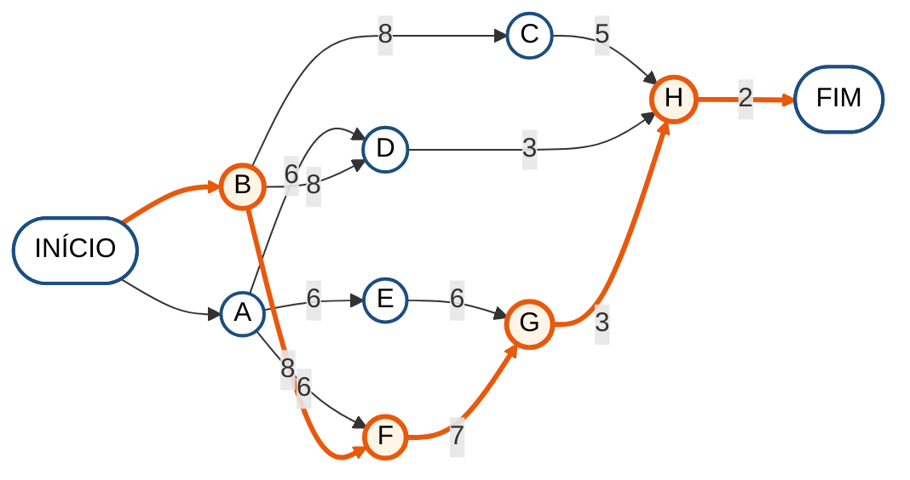

| Atividade | Descrição | Predecessora | Duração (horas) | Início cedo | Término cedo | Início tarde | Término tarde | Folga |
| :---: | :--- | :---: | :---: | :---: | :---: | :---: | :---: | :---: |
| A | Repositórios de contas, transações e transferências (exclusão lógica) | — | 6 | 0 | 6 | 2 | 8 | 2 |
| **B** | Domínio: saldo, divisão de parcelas e geração de recorrências (RN13, RN36, RN37) | — | 8 | 0 | 8 | 0 | 8 | **0** |
| C | Testes unitários de saldo, parcelas e recorrência | B | 5 | 8 | 13 | 13 | 18 | 5 |
| D | Gerador de ocorrências recorrentes na abertura do app | A, B | 3 | 8 | 11 | 15 | 18 | 7 |
| E | Telas Contas, Nova Conta e Transferência | A | 6 | 6 | 12 | 9 | 15 | 3 |
| **F** | Telas Nova Receita e Nova Despesa (conta principal, data de hoje, parcelas, repetir) | A, B | 7 | 8 | 15 | 8 | 15 | **0** |
| **G** | Transações do mês e balanço mensal | E, F | 3 | 15 | 18 | 15 | 18 | **0** |
| **H** | Teste de integração do requisito | C, D, G | 2 | 18 | 20 | 18 | 20 | **0** |

**Caminho crítico:** B → F → G → H = 8 + 7 + 3 + 2 = **20 horas**.

---

## 7. RF06 — Categorizar transações

Categorias, subcategorias, tags e gráfico de despesas por categoria.

**Caminho crítico = 8 horas** · **Esforço total = 16 horas** (8 dias de 2 h na rede geral)

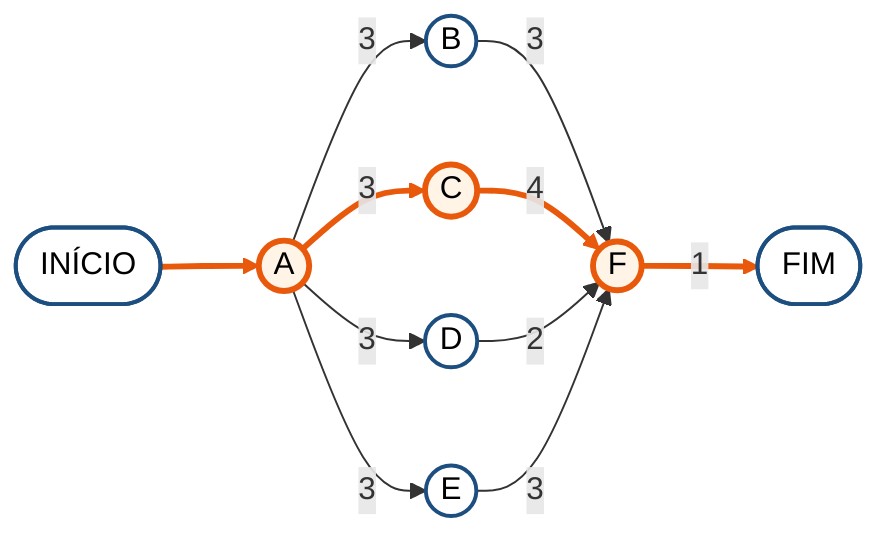

| Atividade | Descrição | Predecessora | Duração (horas) | Início cedo | Término cedo | Início tarde | Término tarde | Folga |
| :---: | :--- | :---: | :---: | :---: | :---: | :---: | :---: | :---: |
| **A** | Repositórios de categorias e tags | — | 3 | 0 | 3 | 0 | 3 | **0** |
| B | Regras de subcategoria e de exclusão no app (RN11, RN16) | A | 3 | 3 | 6 | 4 | 7 | 1 |
| **C** | Telas Categorias e Nova Categoria (categoria-pai) | A | 4 | 3 | 7 | 3 | 7 | **0** |
| D | Tags no registro de receitas e despesas | A | 2 | 3 | 5 | 5 | 7 | 2 |
| E | Gráfico de despesas por categoria (RN17) | A | 3 | 3 | 6 | 4 | 7 | 1 |
| **F** | Teste de integração do requisito | B, C, D, E | 1 | 7 | 8 | 7 | 8 | **0** |

**Caminho crítico:** A → C → F = 3 + 4 + 1 = **8 horas**.

---

## 8. RF07 — Gerir rotinas de treino

Pastas, rotinas, dias da semana e exercícios.

**Caminho crítico = 11 horas** · **Esforço total = 20 horas** (10 dias de 2 h na rede geral)

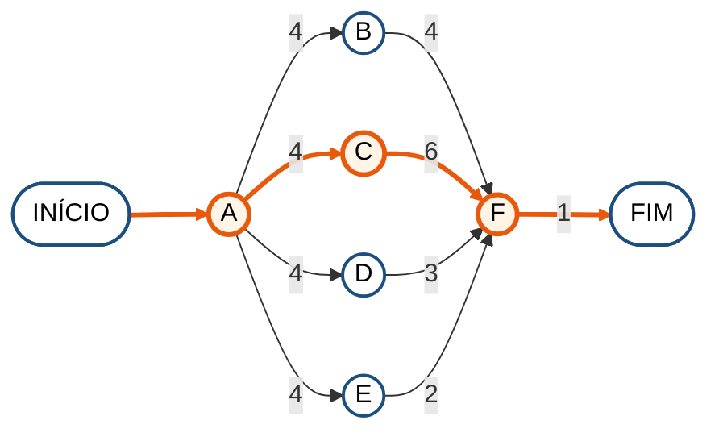

| Atividade | Descrição | Predecessora | Duração (horas) | Início cedo | Término cedo | Início tarde | Término tarde | Folga |
| :---: | :--- | :---: | :---: | :---: | :---: | :---: | :---: | :---: |
| **A** | Repositórios de pastas, rotinas e exercícios (dados padrão) | — | 4 | 0 | 4 | 0 | 4 | **0** |
| B | Telas Rotinas e Pastas | A | 4 | 4 | 8 | 6 | 10 | 2 |
| **C** | Tela Nova Rotina: dias da semana, local e exercícios | A | 6 | 4 | 10 | 4 | 10 | **0** |
| D | Tela Adicionar Exercício: busca e filtros | A | 3 | 4 | 7 | 7 | 10 | 3 |
| E | Regra da agenda do dia e seus testes (RN23) | A | 2 | 4 | 6 | 8 | 10 | 4 |
| **F** | Teste de integração do requisito | B, C, D, E | 1 | 10 | 11 | 10 | 11 | **0** |

**Caminho crítico:** A → C → F = 4 + 6 + 1 = **11 horas**.

---

## 9. RF08 — Registrar treinos e exercícios

Sessão, séries, histórico, recordes, estatísticas e peso corporal.

**Caminho crítico = 14 horas** · **Esforço total = 28 horas** (14 dias de 2 h na rede geral)

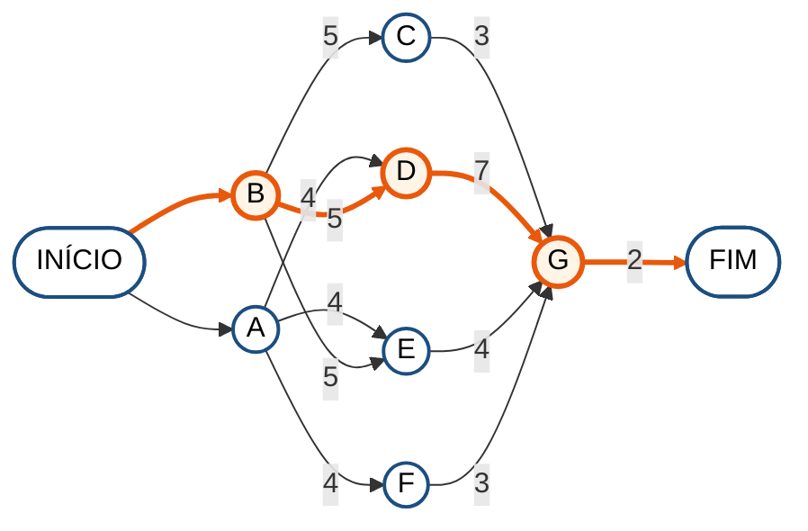

| Atividade | Descrição | Predecessora | Duração (horas) | Início cedo | Término cedo | Início tarde | Término tarde | Folga |
| :---: | :--- | :---: | :---: | :---: | :---: | :---: | :---: | :---: |
| A | Repositórios de sessões e séries | — | 4 | 0 | 4 | 1 | 5 | 1 |
| **B** | Domínio: recordes, volume e coluna Anterior (RN24) | — | 5 | 0 | 5 | 0 | 5 | **0** |
| C | Testes unitários de recordes | B | 3 | 5 | 8 | 9 | 12 | 4 |
| **D** | Tela Treino em Andamento: séries, descanso, finalizar e descartar | A, B | 7 | 5 | 12 | 5 | 12 | **0** |
| E | Telas Histórico e Estatísticas (frequência) | A, B | 4 | 5 | 9 | 8 | 12 | 3 |
| F | Registro do peso corporal e meta (RN25) | A | 3 | 4 | 7 | 9 | 12 | 5 |
| **G** | Teste de integração do requisito | C, D, E, F | 2 | 12 | 14 | 12 | 14 | **0** |

**Caminho crítico:** B → D → G = 5 + 7 + 2 = **14 horas**.

---

## 10. RF09 — Gerir tarefas

Pastas e tarefas com prazo e prioridade.

**Caminho crítico = 8 horas** · **Esforço total = 14 horas** (7 dias de 2 h na rede geral)

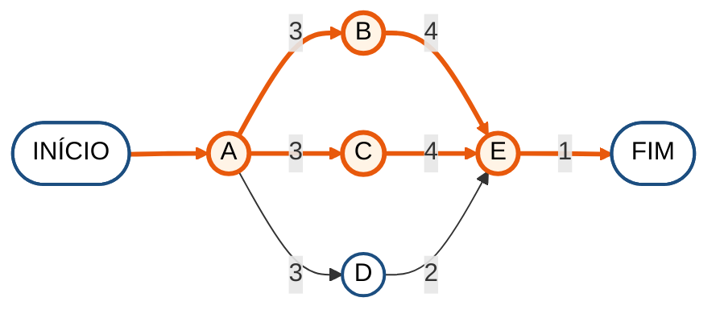

| Atividade | Descrição | Predecessora | Duração (horas) | Início cedo | Término cedo | Início tarde | Término tarde | Folga |
| :---: | :--- | :---: | :---: | :---: | :---: | :---: | :---: | :---: |
| **A** | Repositórios de pastas e tarefas (pasta padrão, RN27) | — | 3 | 0 | 3 | 0 | 3 | **0** |
| **B** | Telas Atividades, Pasta e Nova Pasta | A | 4 | 3 | 7 | 3 | 7 | **0** |
| **C** | Tela Nova Atividade: prazo com data e hora local, prioridade | A | 4 | 3 | 7 | 3 | 7 | **0** |
| D | Testes das regras de pasta | A | 2 | 3 | 5 | 5 | 7 | 2 |
| **E** | Teste de integração do requisito | B, C, D | 1 | 7 | 8 | 7 | 8 | **0** |

**Caminho crítico:** A → B → E e A → C → E = 3 + 4 + 1 = **8 horas**.

---

## 11. RF10 — Concluir atividades

Concluir, desmarcar e arquivar tarefas; progresso do dia.

**Caminho crítico = 6 horas** · **Esforço total = 6 horas** (3 dias de 2 h na rede geral)

| Atividade | Descrição | Predecessora | Duração (horas) | Início cedo | Término cedo | Início tarde | Término tarde | Folga |
| :---: | :--- | :---: | :---: | :---: | :---: | :---: | :---: | :---: |
| **A** | Concluir, desmarcar e arquivar (RN26) | — | 2 | 0 | 2 | 0 | 2 | **0** |
| **B** | Progresso do dia e filtros Hoje, Atrasadas e Próximas (RN29) | A | 3 | 2 | 5 | 2 | 5 | **0** |
| **C** | Teste de integração do requisito | B | 1 | 5 | 6 | 5 | 6 | **0** |

**Caminho crítico:** A → B → C = 2 + 3 + 1 = **6 horas**.

---

## 12. RF11 — Backup na conta Google

Backup cifrado no Google Drive do usuário e restauração.

**Caminho crítico = 16 horas** · **Esforço total = 28 horas** (14 dias de 2 h na rede geral)

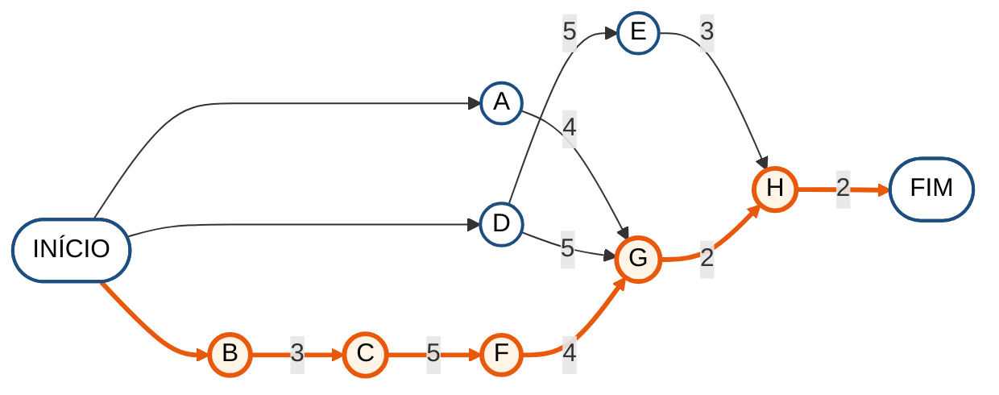

| Atividade | Descrição | Predecessora | Duração (horas) | Início cedo | Término cedo | Início tarde | Término tarde | Folga |
| :---: | :--- | :---: | :---: | :---: | :---: | :---: | :---: | :---: |
| A | Tabela e endpoint da chave de backup (ADR-11) | — | 4 | 0 | 4 | 8 | 12 | 8 |
| **B** | Projeto no Google Cloud e tela de consentimento OAuth | — | 3 | 0 | 3 | 0 | 3 | **0** |
| **C** | Login Google no app (development build) | B | 5 | 3 | 8 | 3 | 8 | **0** |
| D | Cifrar e decifrar com AES-256-GCM | — | 5 | 0 | 5 | 6 | 11 | 6 |
| E | Testes de cifragem e restauração | D | 3 | 5 | 8 | 11 | 14 | 6 |
| **F** | Envio e download do arquivo no Drive | C | 4 | 8 | 12 | 8 | 12 | **0** |
| **G** | Telas Backup e Restaurar backup | A, D, F | 2 | 12 | 14 | 12 | 14 | **0** |
| **H** | Teste de integração do requisito | E, G | 2 | 14 | 16 | 14 | 16 | **0** |

**Caminho crítico:** B → C → F → G → H = 3 + 5 + 4 + 2 + 2 = **16 horas**.

---

## 13. RF12 — Comunicar com a plataforma

Feedbacks, avisos globais e Área de Administração.

**Caminho crítico = 14 horas** · **Esforço total = 20 horas** (10 dias de 2 h na rede geral)

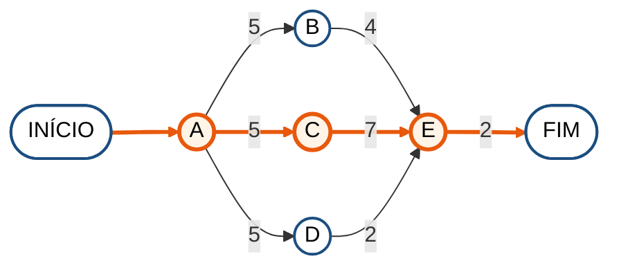

| Atividade | Descrição | Predecessora | Duração (horas) | Início cedo | Término cedo | Início tarde | Término tarde | Folga |
| :---: | :--- | :---: | :---: | :---: | :---: | :---: | :---: | :---: |
| **A** | Endpoints de feedback e avisos, com conferência de perfil (RN41) | — | 5 | 0 | 5 | 0 | 5 | **0** |
| B | Telas Enviar Feedback e Notificações | A | 4 | 5 | 9 | 8 | 12 | 3 |
| **C** | Área de Administração: feedbacks, avisos e gerenciar ADMs | A | 7 | 5 | 12 | 5 | 12 | **0** |
| D | Testes de autorização por perfil (403) | A | 2 | 5 | 7 | 10 | 12 | 5 |
| **E** | Teste de integração do requisito | B, C, D | 2 | 12 | 14 | 12 | 14 | **0** |

**Caminho crítico:** A → C → E = 5 + 7 + 2 = **14 horas**.

---

## 14. RF13 — Compartilhar rotina

Compartilhar a rotina como texto ou imagem (RN39).

**Caminho crítico = 8 horas** · **Esforço total = 8 horas** (4 dias de 2 h na rede geral)

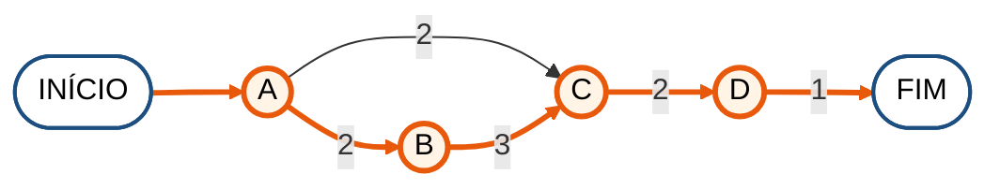

| Atividade | Descrição | Predecessora | Duração (horas) | Início cedo | Término cedo | Início tarde | Término tarde | Folga |
| :---: | :--- | :---: | :---: | :---: | :---: | :---: | :---: | :---: |
| **A** | Texto formatado da rotina | — | 2 | 0 | 2 | 0 | 2 | **0** |
| **B** | Imagem do card da rotina | A | 3 | 2 | 5 | 2 | 5 | **0** |
| **C** | Menu de compartilhamento do Android | A, B | 2 | 5 | 7 | 5 | 7 | **0** |
| **D** | Teste de integração do requisito | C | 1 | 7 | 8 | 7 | 8 | **0** |

**Caminho crítico:** A → B → C → D = 2 + 3 + 2 + 1 = **8 horas**.

---

## 15. Resumo dos caminhos críticos

| Requisito | Nome | Caminho crítico | Caminho crítico (horas) | Esforço total (horas) | Duração na rede geral (dias) |
| :---: | :--- | :--- | :---: | :---: | :---: |
| RF01 | Gerir usuários | A → C → E → F | 18 | 24 | 12 |
| RF02 | Autenticar acesso | A → B → D → F → G | 23 | 32 | 16 |
| RF03 | Visualizar central | A → B → D → E | 10 | 12 | 6 |
| RF04 | Centralizar dados | B → D → E | 7 | 10 | 5 |
| RF05 | Gerir finanças | B → F → G → H | 20 | 40 | 20 |
| RF06 | Categorizar transações | A → C → F | 8 | 16 | 8 |
| RF07 | Gerir rotinas de treino | A → C → F | 11 | 20 | 10 |
| RF08 | Registrar treinos e exercícios | B → D → G | 14 | 28 | 14 |
| RF09 | Gerir tarefas | A → B → E A → C → E | 8 | 14 | 7 |
| RF10 | Concluir atividades | A → B → C | 6 | 6 | 3 |
| RF11 | Backup na conta Google | B → C → F → G → H | 16 | 28 | 14 |
| RF12 | Comunicar com a plataforma | A → C → E | 14 | 20 | 10 |
| RF13 | Compartilhar rotina | A → B → C → D | 8 | 8 | 4 |

Nos requisitos dos módulos locais (RF03 a RF10 e RF13), o caminho crítico vai do repositório ou da regra de domínio para a tela e termina no teste de integração. Nos requisitos que dependem da nuvem (RF01, RF02, RF11 e RF12), ele começa na API, porque a tela só pode consumir um endpoint depois que a regra e o endpoint estão prontos. Os testes unitários quase sempre têm folga, porque podem ser escritos em paralelo com as telas. RF10 e RF13 são sequenciais do começo ao fim, então o caminho crítico é igual ao esforço total.
