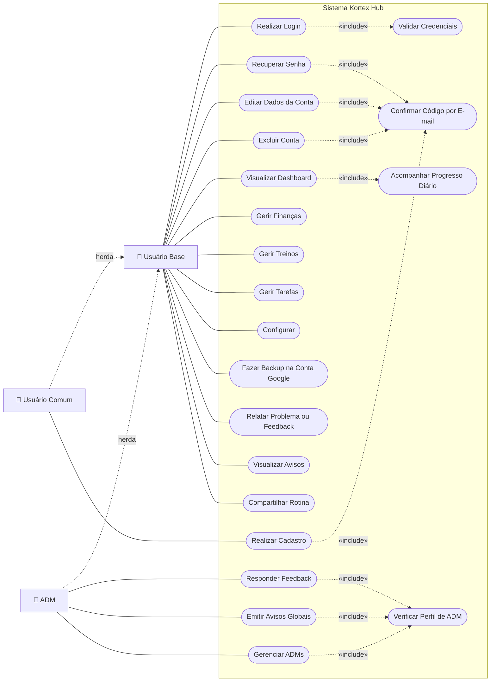
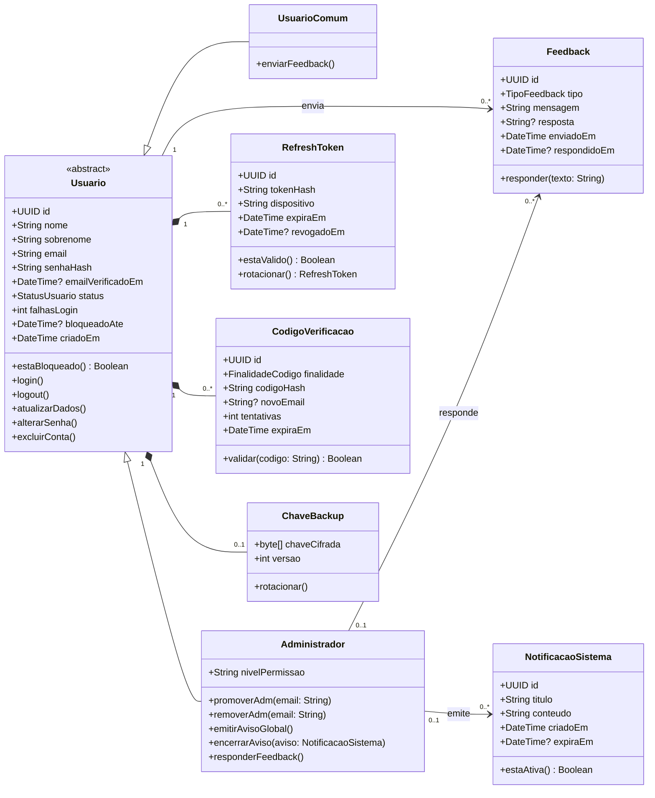
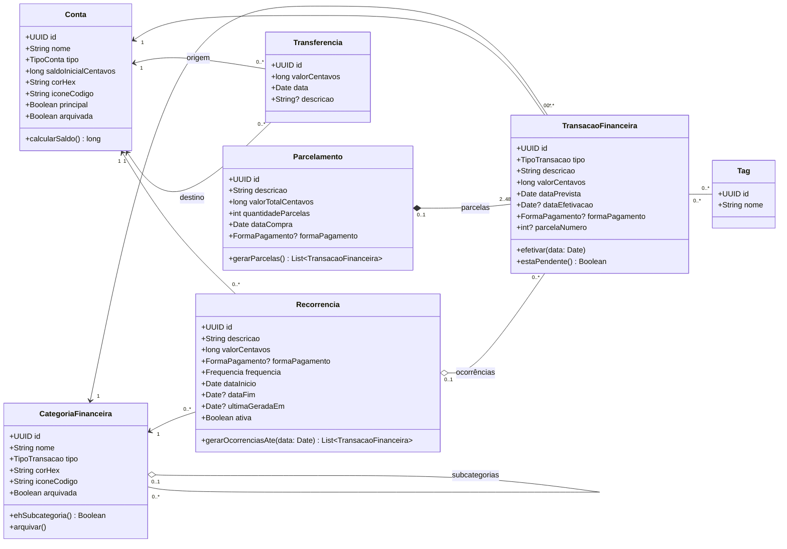
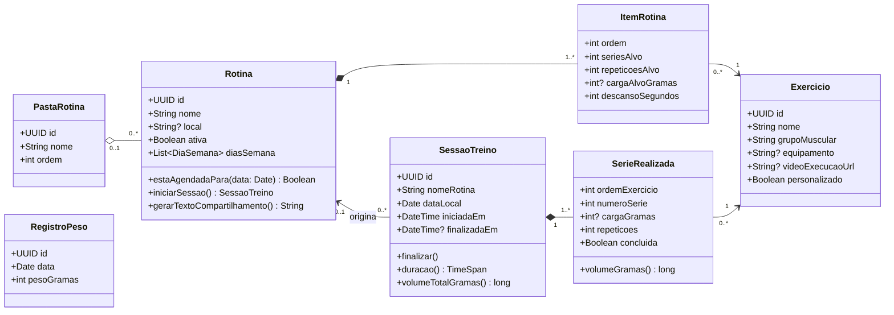
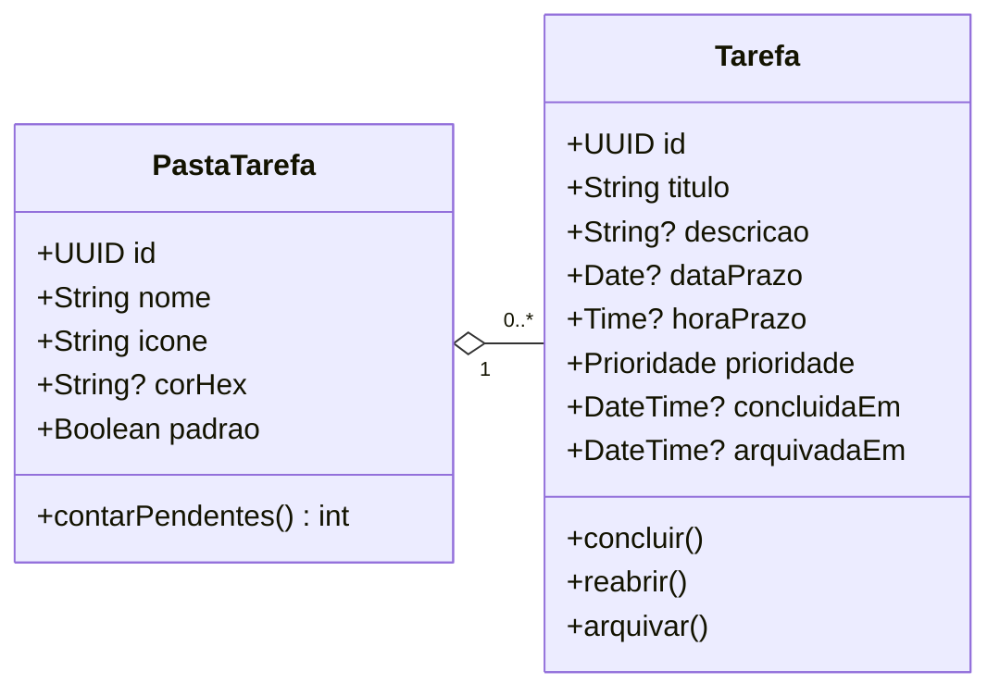
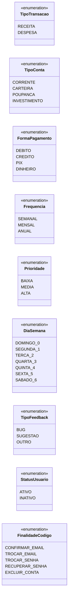
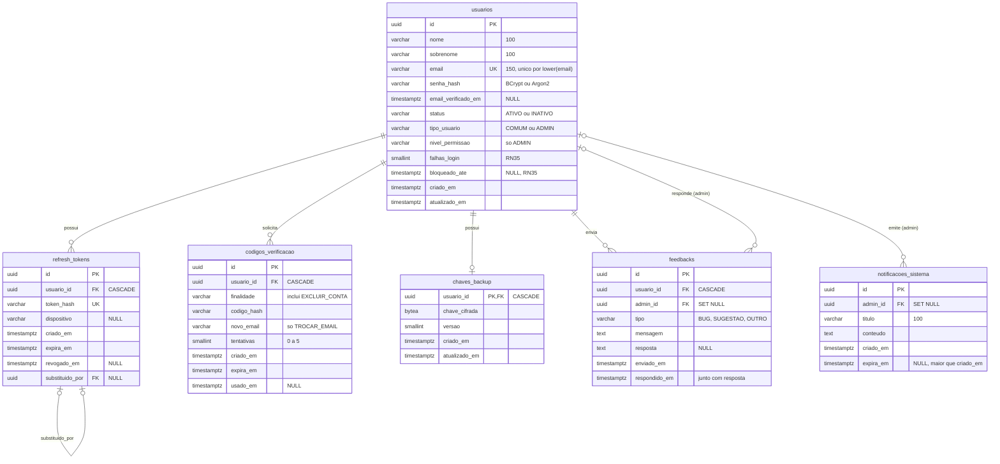
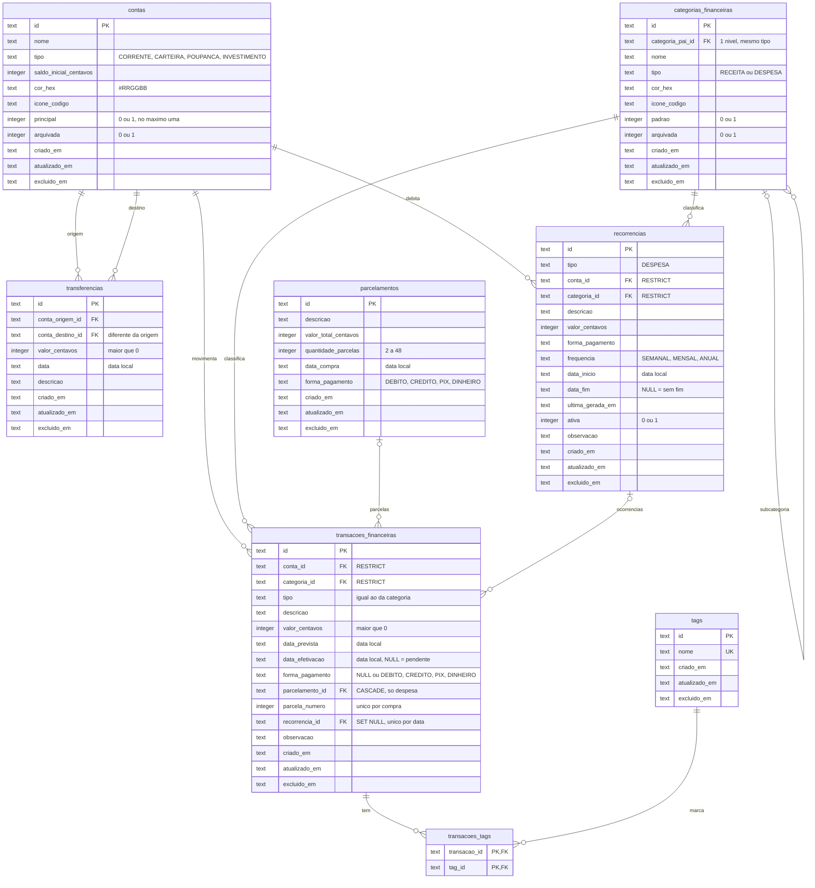
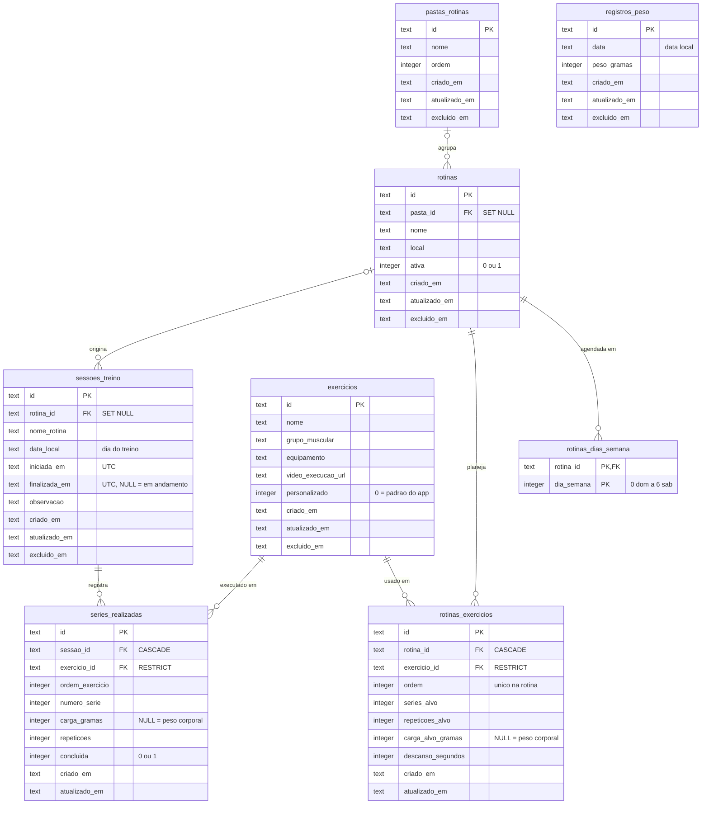
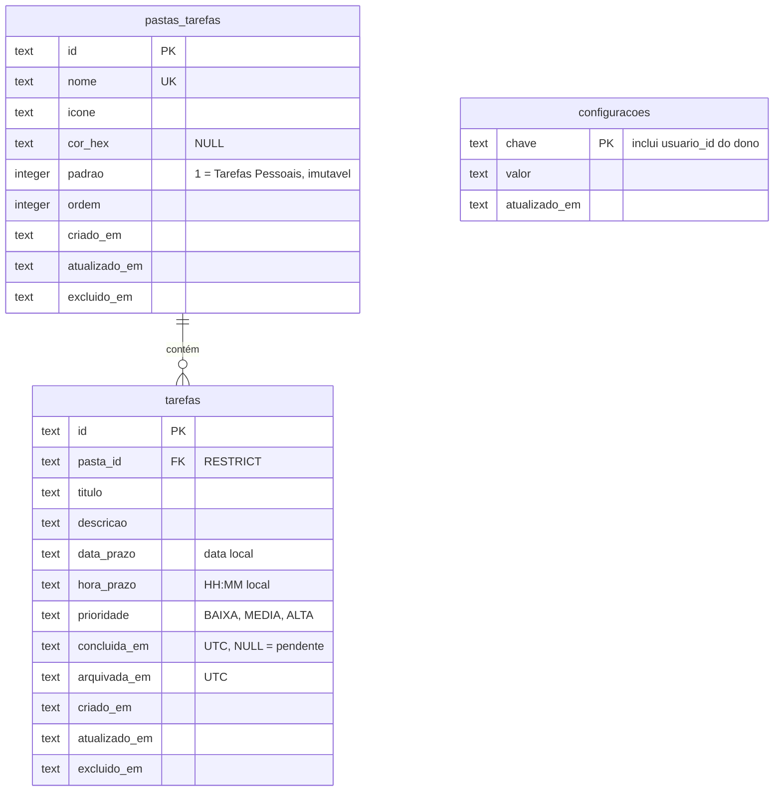

# 📐 Diagramas — Kortex Hub

Diagramas em [Mermaid](https://mermaid.js.org/), renderizados pelo próprio GitHub. São a versão oficial e acompanham os scripts em [`Docs/Dicionario Dados e DDL`](../Docs/Dicionario%20Dados%20e%20DDL/README.md); os arquivos `.drawio` e `.png` desta pasta ficam como histórico da v2.

**Sumário:** [Casos de uso](#1-casos-de-uso) · [Classes](#2-diagrama-de-classes) · [DER](#3-der--modelo-entidade-relacionamento)

**Documentos relacionados:** [Descrição dos Atores e Casos de Uso](Descricao_Casos_de_Uso.md) · [Diagrama de Rede (CPM)](Diagrama_de_Rede.md)

---

## 1. Casos de Uso

> O Mermaid não tem diagrama de casos de uso UML. A representação abaixo usa um fluxograma: atores são retângulos, casos de uso são elipses dentro da fronteira do sistema, e a herança entre atores aparece como seta tracejada `herda`.

A descrição completa de cada ator e caso de uso (resumo, pré-condição, fluxo principal, fluxos alternativos, regras e pós-condição) está em [Descrição dos Atores e Casos de Uso](Descricao_Casos_de_Uso.md).

| Caso de uso | Requisito | Regras |
| :--- | :--- | :--- |
| Realizar Cadastro, Editar Dados da Conta, Excluir Conta | RF01 | RN01, RN05, RN34 |
| Realizar Login, Recuperar Senha, Validar Credenciais | RF02 | RN03, RN04, RN05, RN07 |
| Visualizar Dashboard, Acompanhar Progresso Diário | RF03, RF04 | RN08, RN09, RN29 |
| Gerir Finanças | RF05, RF06 | RN10–RN18, RN36–RN38 |
| Gerir Treinos | RF07, RF08 | RN19–RN25 |
| Compartilhar Rotina | RF13 | RN39 |
| Gerir Tarefas | RF09, RF10 | RN26–RN29 |
| Fazer Backup na Conta Google | RF11 | RN31, RN32 |
| Relatar Problema ou Feedback, Visualizar Avisos | RF12 | RN30 |
| Responder Feedback, Emitir Avisos Globais, Gerenciar ADMs, Verificar Perfil de ADM | RF01, RF12 | RN06, RN41 (Área de Administração no próprio app) |
| Configurar | RNF05 | RN40 (tema claro/escuro) e preferências do app (`configuracoes`) |

---

## 2. Diagrama de Classes

Classes da nuvem ficam na Web API (C#). Classes dos módulos ficam no app; cada usuário tem o próprio banco local (ADR-13), então elas não têm `usuarioId`. Valores em centavos (`long`) e gramas (`int`) — ADR-08. `Date` = data local, `DateTime` = instante UTC, `Time` = hora local — ADR-12.

### 2.1 Nuvem — Web API C#

### 2.2 App — Finanças

### 2.3 App — Treinos

### 2.4 App — Tarefas

### 2.5 Enumerações

---

## 3. DER — Modelo Entidade-Relacionamento

Convenções: PK = UUID v4 (ADR-04) · dinheiro em centavos e peso em gramas (ADR-08) · data local, hora local e instante UTC (ADR-12) · `criado_em` / `atualizado_em` / `excluido_em` = auditoria e soft delete (ADR-09) · um arquivo SQLite por usuário, sem `usuario_id` nas tabelas locais (ADR-13). Os comentários entre aspas resumem as restrições; o detalhe está no dicionário de dados.

### 3.1 Nuvem — Supabase (PostgreSQL) · schema privado `kortex`, acesso só pelo papel `kortex_api` (ADR-05)

### 3.2 Local — Finanças (SQLite)

**Visão `vw_saldo_contas`:** saldo = saldo inicial + receitas efetivadas − despesas efetivadas + transferências recebidas − enviadas (RN13).

### 3.3 Local — Treinos (SQLite)

**Visão `vw_recordes_exercicios`:** recordes de carga, volume e repetições por exercício (RN24).

### 3.4 Local — Tarefas e Geral (SQLite)

> Tokens (API e Google OAuth) ficam no SecureStore do Android, não no banco.
